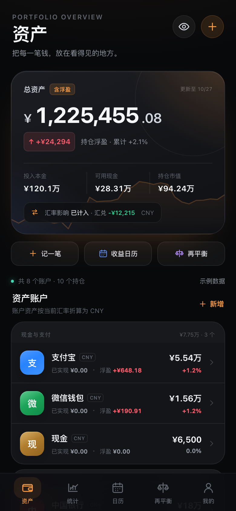
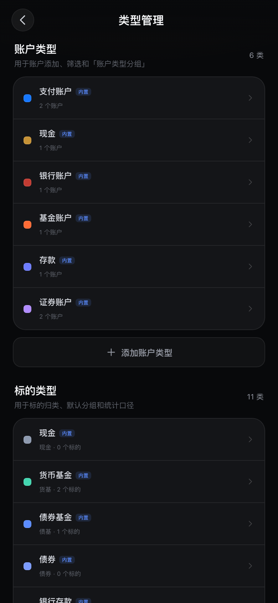

# 有余 · 投资组合

为 iPhone 打造的本地优先投资收益统计单页应用。外观走深色卡片风，交互尽量接近原生 App：底部 Tab、底部弹层、安全区适配，并支持添加到主屏幕。





## 功能

- **资产账户**：支持支付宝、微信钱包、现金、银行、基金、定存、证券等账户；账户下可添加具体标的。
- **演示/真实账本**：演示账本独立存储，与真实账本完全分离；可随时切换，互不影响。
- **记一笔**：存入和取出支持「变化金额 / 变化后余额」两种输入方式，按历史日期自动计算操作前余额。
- **账户/标的详情**：价格走势、累计收益金额、区间收益、最大回撤、资产构成、持仓概览、更新记录。
- **资金流图**：投入、转出、净投入、资产盈亏、期末金额，以及期初到期末的勾稽关系。
- **收益日历**：日、周、月、年视图，按分组过滤，金额/收益率切换，单日明细；页面底部走势支持「金额 / 收益率」切换并跟随分组。
- **统计与桑基图**：内置「账户分组」「标的分组」「账户类型分组」「标的类型分组」四种自动分组，并支持自定义分组；展示环形图、桑基图和分组表现。
- **类型管理**：在「我的 → 类型管理」维护账户类型和标的类型，支持新增、改名、改色；内置类型不可删除，自定义类型在未被使用时可以删除。
- **分组编辑**：自定义分组用账户树选择成员，账户下单独列出账户现金和标的；已被其他分组选择的成员会置灰。
- **组合走势跟随筛选**：日历页底部的走势会跟随顶部选中的分组方式和具体分组。
- **再平衡**：当前 vs 目标双环形图、目标容忍带、偏离金额、加仓/减仓建议；每个分组方式（含默认分组）都有「参与再平衡」开关，开启后可设置目标。
- **记录编辑**：每一条资金/交易记录都可编辑或删除，保存后重新计算持仓与收益。
- **账户资金流调整**：可按记账以来或年份切换；期初、期末、资产盈亏、投入、转出均可点击调整，并写入账本、同步更新资产统计。
- **行情匹配**：添加标的时可搜索 A股、场外基金、场内 ETF、美股、港股、债券，自动填入名称、代码、类别、币种和最新价；打开标的详情时会按所选时间范围加载真实历史行情，打开 App 时自动同步最新报价。
- **多币种**：本币切换、手动汇率、买入时成交汇率、汇兑损益开关。
- **记账**：存入、取出、买入、卖出、分红、利息、费用、估值更新、换汇。
- **本地数据**：localStorage 持久化，JSON 导入/导出，隐藏金额，恢复示例、清空账本。
- **日间/夜间模式**：支持浅色日间界面与深色夜间界面，外观偏好独立保存。
- **前端零依赖**：图表使用原生 SVG 手写实现，不依赖 CDN 或前端框架。行情搜索/报价会访问新浪财经、腾讯行情和东方财富的公开接口。

## 项目结构

```text
youyu.html              # 构建后的单文件应用，可直接部署
youyu-src/
  template.html          # HTML 模板
  styles.css             # 样式
  js/                    # 按功能拆分的前端源码（含行情/类型管理模块）
build_youyu.py          # 构建脚本：内联 CSS/JS 生成 youyu.html
previews/                # 页面截图
```

## 构建

仅需 Python 3，无第三方依赖：

```bash
python3 build_youyu.py
```

输出 `youyu.html`。

## 自动发布到 Netlify

首次配置：

1. 在 Netlify 的 User settings → Applications → Personal access tokens 创建 token。
2. 把 token 写入工作区 `.netlify-token`（该文件已被 `.gitignore` 忽略）。
3. 运行 `python3 deploy_netlify.py --list` 查看 `cong-yu` 团队下的站点。
4. 把选中的 Site ID 写入 `.netlify-site-id`。

之后每次更新运行：

```bash
python3 deploy_netlify.py
```

脚本会自动构建 `youyu.html`、生成 `youyu-netlify.zip`、上传到 Netlify，并等待部署完成。

## 部署到 iPhone

推荐 Netlify Drop：

1. 将 `youyu.html` 复制或重命名为 `index.html`。
2. 打开 [Netlify Drop](https://app.netlify.com/drop)，拖入 `index.html` 或包含它的文件夹。
3. 用 Safari 打开生成的 `https://` 地址。
4. 分享 → 添加到主屏幕。

也可以部署到 GitHub Pages、Vercel、Netlify、nginx 等任何静态托管。应用使用 hash 路由，不需要服务端 rewrite。

> 微信、QQ、iOS 文件 App 的 HTML 预览通常是静态的，交互按钮不会响应，必须用 Safari/Chrome 打开实际网址。

## 数据说明

- 所有数据保存在当前浏览器的 localStorage，不上传服务器。
- 换设备或换域名不会自动同步。
- 建议定期在「我的 → 导出账本」备份 JSON。
- 行情搜索与报价来自新浪财经、腾讯行情的公开接口，可能受网络、接口策略或 CORS 限制；接口不可用时仍可手动填写价格。
- 匹配行情的标的会从公开接口加载历史价格（A股/港股/ETF/债券、场外基金净值、美股日线），无法获取时回退到已有记录。
- 无法匹配行情的标的严格按用户记录生成价格点；价格点由买入、卖出和估值更新记录重建，不保留无来源历史点。
- 标的「累计收益」按金额展示，使用已实现、浮动、分红、手续费和汇兑损益计算，终点与顶部累计收益一致。
- 自动行情和自动历史加载不会写入更新记录，更新记录只保留用户实际操作。
- 演示标的与真实标的走同一套行情和历史逻辑；演示交易价格会按真实历史收盘价校准，避免演示收益失真。
- 演示账本独立存储，不进入真实账本统计；真实账本也不受演示操作影响。
- 汇率仍由「我的 → 汇率管理」手动维护，不接入实时汇率接口。
- 内置数据为独立演示账本；在「我的 → 退出演示」即可进入自己的真实账本，两者互不影响。
- 账户级资金流调整会写入账本并影响资产统计；标的级资金流仅展示，不再提供校正。
- 删除资金流调整记录或使用「撤销调整」会回滚对应的资产变动。

## 说明

本项目仅用于个人资产记录与统计，不构成投资建议。
